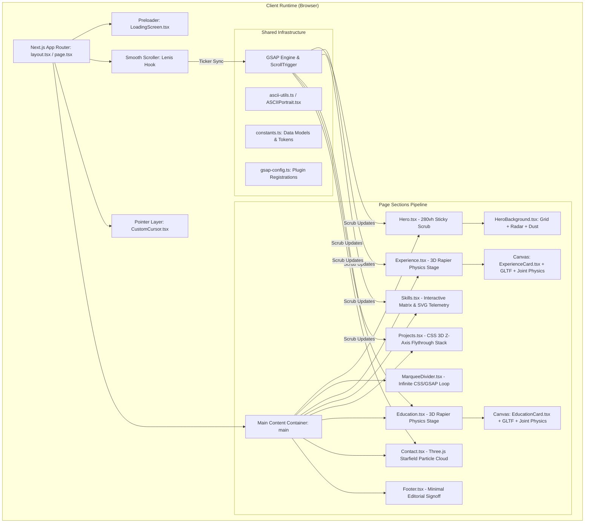

# System Architecture & Technical Specification
## Creative Developer 3D Editorial Portfolio

---

## 1. System Architecture Overview

The portfolio is structured as a client-orchestrated Next.js 16 application leveraging React 19, Three.js (via React Three Fiber & Drei), Rapier Physics, GSAP ScrollTrigger, and Lenis.



---

## 2. Technology Stack & Dependency Matrix

| Technology | Version | Purpose in Architecture | Key Rationale |
| :--- | :--- | :--- | :--- |
| **Next.js** | `16.2.10` | Application framework, routing, asset bundling | Fast builds, App Router structure, server-side asset optimization. |
| **React & React DOM** | `19.2.4` | Component tree, hooks, reactive rendering | Modern concurrency, lightweight hooks, modern DOM reconciliation. |
| **TypeScript** | `^5.0.0` | Type safety and interface contracts | Strict data typing for 3D props, vectors, and portfolio entities. |
| **Three.js** | `^0.185.1` | WebGL rendering engine | Core 3D scene graph, math utilities (`Vector3`, matrices), shaders. |
| **@react-three/fiber** | `^9.6.1` | React renderer for Three.js (R3F) | Declarative 3D scene management, reactive mesh bindings, `useFrame` loop. |
| **@react-three/drei** | `^10.7.7` | R3F utility library | `useGLTF`, `useTexture`, `Environment`, `Lightformer`, `Float`. |
| **@react-three/rapier** | `^2.2.0` | Real-time WASM physics engine | RigidBody dynamics, rope joints, spherical joints, and collider simulation. |
| **meshline** | `^3.3.1` | 3D strip line geometry | Smooth variable-width ribbon rendering for the lanyard strap. |
| **GSAP** | `^3.15.0` | High-performance animation engine | Timeline choreography, micro-staggers, and ScrollTrigger scrub binds. |
| **@gsap/react** | `^2.1.2` | React integration for GSAP | Safe scoped cleanup of GSAP animations within React component lifecycles. |
| **Framer Motion** | `^12.42.2` | Spring-based UI transitions | Interactive hover scaling, layout transitions, modal expansions. |
| **Lenis** | `^1.3.25` | Smooth inertia scroll provider | Normalizes scroll momentum across operating systems and browsers. |
| **Tailwind CSS** | `^4.0.0` | Atomic utility styling | CSS-first config using `@import "tailwindcss"` and custom properties. |
| **Lucide React** | `^1.24.0` | UI iconography | Lightweight feather-style vector icons for theme & navigation controls. |

---

## 3. Directory & File Structure

```
e:/port/GSAP-Portfolio/
├── Doc/                             # System documentation & generation blueprints
│   ├── PRD.md                       # Product Requirements Document
│   ├── ARCHITECTURE.md              # System Architecture & Technical Specifications
│   ├── RULES.md                     # Coding Standards, Constraints & Best Practices
│   ├── DESIGN.md                    # Visual Design System & Tokens
│   ├── TASKS.md                     # Milestones, Roadmap & Generation Prompts
│   ├── MEMORY.md                    # Historical Decisions & Technical Gotchas
│   └── DATA.md                      # Content Data Registry & Schema
├── public/                          # Static public assets
│   ├── card.glb                     # 3D Badging Model with UV mapping
│   ├── lanyard.png                  # Lanyard fabric texture pattern 1
│   ├── lanyard2.png                 # Alternative lanyard texture pattern
│   └── images/                      # Developer portraits & project screenshots
│       ├── profile.png              # Clean cutout portrait used in Hero
│       └── ...
├── src/
│   ├── app/                         # Next.js App Router root
│   │   ├── globals.css              # Design tokens, typography, background keyframes
│   │   ├── layout.tsx               # Root HTML metadata and font bindings
│   │   └── page.tsx                 # Master page entry, preloader & section sequencing
│   ├── components/
│   │   ├── 3d/                      # WebGL R3F Scenes & Physics Simulation
│   │   │   ├── ExperienceCard.tsx   # Rapier rope joints + CanvasTexture UV badge
│   │   │   └── EducationCard.tsx    # Academic credential badge variant
│   │   ├── ascii/                   # ASCII Art & Terminal components
│   │   │   ├── ASCIICanvas.tsx      # Canvas-based ASCII particle field
│   │   │   └── ASCIIPortrait.tsx    # Real-time brightness-to-character ASCII mapper
│   │   ├── sections/                # Full-screen page sections
│   │   │   ├── Hero.tsx             # 280vh sticky pinned hero scrub
│   │   │   ├── HeroBackground.tsx   # Radar, grid, dust particle canvas
│   │   │   ├── MarqueeDivider.tsx   # Dual infinite SVG skill tickers
│   │   │   ├── Experience.tsx       # 3D Physics Experience badge scroller
│   │   │   ├── Education.tsx        # 3D Physics Education badge scroller
│   │   │   ├── Skills.tsx           # Interactive categorized skill telemetry
│   │   │   ├── Projects.tsx         # CSS 3D perspective Z-axis flythrough
│   │   │   ├── Contact.tsx          # Three.js particle starfield + magnetic links
│   │   │   ├── LoadingScreen.tsx    # Cinematic preloader curtain reveal
│   │   │   └── Footer.tsx           # Editorial signoff, time ticker, back-to-top
│   │   └── ui/                      # Reusable interface components
│   │       ├── CustomCursor.tsx     # Double-ring glow follower with particle trail
│   │       ├── MagneticButton.tsx   # Physics spring attraction button wrapper
│   │       ├── Navigation.tsx       # Glassmorphism editorial header
│   │       ├── ScrollStack.tsx      # Sticky stacking card mechanism
│   │       └── ScrollStack.css      # Stacking styles
│   ├── hooks/                       # Custom React hooks
│   │   ├── useLenis.ts              # Lenis smooth scroll ticker binding
│   │   ├── useScramble.ts           # Cyberpunk text decryption scramble hook
│   │   ├── useCursorEffect.ts       # Cursor state dispatcher
│   │   └── useASCIIBackground.ts    # ASCII grid simulation hook
│   ├── lib/                         # Utility libraries & configurations
│   │   ├── constants.ts             # Central data stores, colors, and loading steps
│   │   ├── gsap-config.ts           # Safe GSAP & ScrollTrigger registration
│   │   └── ascii-utils.ts           # Brightness and character math helpers
│   └── types/                       # Global TypeScript interfaces
│       └── index.ts                 # Project, Skill, Cursor, and ASCII type definitions
├── next.config.ts                   # Next.js build configuration
├── package.json                     # Dependency manifests & scripts
└── tsconfig.json                    # TypeScript compiler options
```

---

## 4. Component Lifecycle & Hydration Strategy

### 4.1 SSR Guarding
Because the portfolio relies intensely on `window`, `document`, WebGL context APIs, and Canvas objects, standard SSR rendering of 3D or animation components will cause hydration mismatches or server fatal errors.

```tsx
// src/app/page.tsx
export default function Home() {
  const [loading, setLoading] = useState(true);
  const [mounted, setMounted] = useState(false);
  useLenis();

  useEffect(() => {
    setMounted(true);
    registerGSAPPlugins();
  }, []);

  // Minimal SSR fallback — solid luxury black (#050505)
  if (!mounted) {
    return <div style={{ position: 'fixed', inset: 0, background: '#050505' }} />;
  }
  // ...
}
```

### 4.2 Dynamic Client Boundaries
WebGL Canvases and cursor layers are loaded via dynamic imports with `{ ssr: false }`:
```tsx
const CustomCursor = dynamic(() => import('@/components/ui/CustomCursor'), { ssr: false });
const HeroBackground = dynamic(() => import('@/components/sections/HeroBackground'), { ssr: false });
```

---

## 5. 3D WebGL & Physics Architecture

### 5.1 Rapier Physics Rope & Badge System
The 3D credentials system (`ExperienceCard.tsx` and `EducationCard.tsx`) utilizes `@react-three/rapier` to simulate a physical lanyard badge suspended in 3D space:

1. **Rigid Body Topology**:
   - `fixed`: Static pin point anchor at the top (`y: 0, x: 0`).
   - `j1`, `j2`, `j3`: Dynamic spherical colliders with damping (`angularDamping: 4, linearDamping: 4`) simulating intermediate strap links.
   - `card`: Cuboid collider wrapping the ID badge mesh.
2. **Physics Joints**:
   - `useSphericalJoint`: Connects strap segments sequentially to allow free 3D rotation.
   - `useRopeJoint`: Connects the fixed anchor directly to the bottom card, constraining maximum travel distance and creating realistic rope tension.
3. **MeshLine Strap Curve**:
   - In each frame (`useFrame`), Catmull-Rom spline points are interpolated from the joint positions.
   - The points are fed into `MeshLineGeometry.setPoints()`, rendering a continuous smooth fabric lanyard.

### 5.2 Dynamic In-Memory UV Canvas Texture Pipeline
Instead of loading static images for each job or degree, the component paints details directly onto the 3D model's texture atlas at runtime:

```typescript
// Dynamically draw experience credentials onto an in-memory CanvasTexture
const cardMap = useMemo(() => {
  const baseImg = materials.base.map.image;
  const canvas = document.createElement('canvas');
  canvas.width = baseImg.width;
  canvas.height = baseImg.height;
  const ctx = canvas.getContext('2d');
  
  // 1. Draw base ID card plastic geometry
  ctx.drawImage(baseImg, 0, 0, canvas.width, canvas.height);
  
  // 2. Render high-res typography (Company, Role, Dates, Description)
  ctx.font = 'bold 36px Inter';
  ctx.fillStyle = '#ffffff';
  ctx.fillText(data.role, 60, 180);
  
  // 3. Return a live THREE.CanvasTexture assigned to the mesh material
  const texture = new THREE.CanvasTexture(canvas);
  texture.needsUpdate = true;
  return texture;
}, [data]);
```

---

## 6. Motion & Scroll Engine Architecture

### 6.1 Lenis Smooth Scroll & GSAP Integration
Inertia scrolling is decoupled from standard browser wheel events using Lenis. The GSAP ticker drives the Lenis render cycle to guarantee zero phase-shift between native scroll and ScrollTrigger scrubs:

```typescript
// src/hooks/useLenis.ts
export function useLenis() {
  useEffect(() => {
    const lenis = new Lenis({
      duration: 1.2,
      easing: (t) => Math.min(1, 1.001 - Math.pow(2, -10 * t)),
      orientation: 'vertical',
      smoothWheel: true,
    });

    lenis.on('scroll', ScrollTrigger.update);
    gsap.ticker.add((time) => lenis.raf(time * 1000));
    gsap.ticker.lagSmoothing(0);

    return () => {
      lenis.destroy();
      gsap.ticker.remove(lenis.raf);
    };
  }, []);
}
```

### 6.2 Sticky Scrub Mathematics (Hero & Projects)
- **Hero Section**: Outer wrapper set to `height: 280vh` with inner container `position: sticky; top: 0; height: 100vh; overflow: hidden;`.
- **Scrub Ratio**: `scrub: 1.6` provides natural momentum smoothing.
- **Scroll Phases in Hero**:
  - `0.00 -> 0.30`: Split letter typography elevates and dissipates; portrait glides from center to `-25vw`.
  - `0.00 -> 0.25`: Narrative Panel 1 slides in from `50vw` and dissolves.
  - `0.32 -> 0.58`: Narrative Panel 2 (Cyberpunk Terminal & Stats) slides in and dissolves.
  - `0.68 -> 1.00`: Narrative Panel 3 (Disciplines) enters and locks in place.
- **Projects Section 3D Z-Axis Scrub**:
  - Outer container: `height: 500vh`.
  - Inner container: `position: sticky; top: 0; perspective: 1200px;`.
  - Card positions: `currentZ = (-i * 1600 - 800) + (progress * totalTravel)`.
  - Camera passing: When `currentZ > 200px`, opacity fades (`1 - (currentZ - 200)/400`) and blur activates (`(currentZ - 200)/20`).

---

## 7. Performance & Memory Management

1. **Geometry & Material Reuse**: Meshes and shaders are never instantiated in `useFrame` or tick loops. They are memoized via `useMemo` or declared at module scope.
2. **WebGL Context Preservation**: The application enforces a single Canvas instance per section. Offscreen Canvases are unmounted or paused via `ScrollTrigger` visibility guards.
3. **Texture Cleanliness**: Canvas-generated textures are properly disposed of using `texture.dispose()` on data change to prevent VRAM memory leaks.
4. **Hardware Acceleration**: Animated DOM elements leverage `will-change: transform, opacity;` and GPU-accelerated transforms (`translate3d`).
